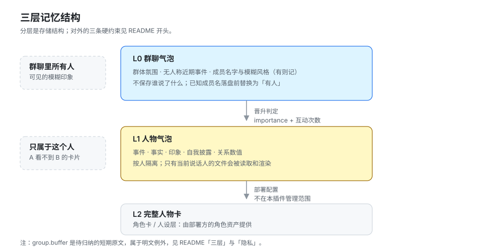
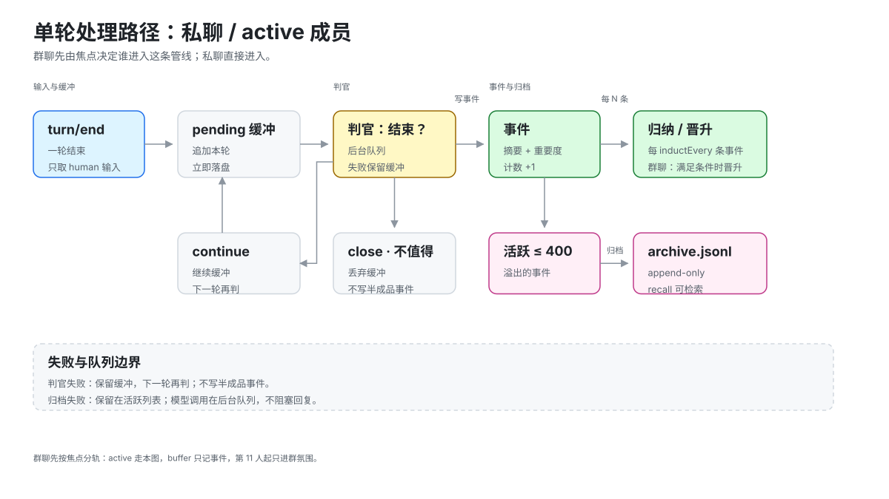
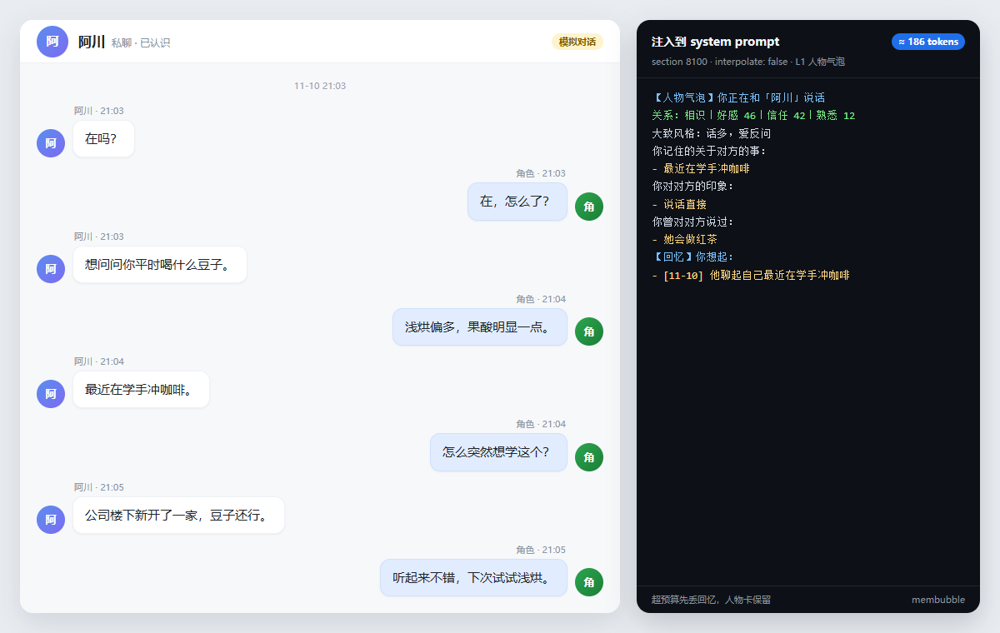
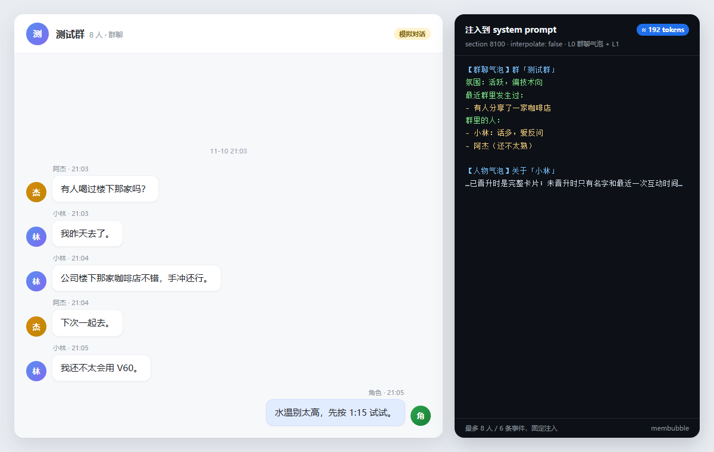
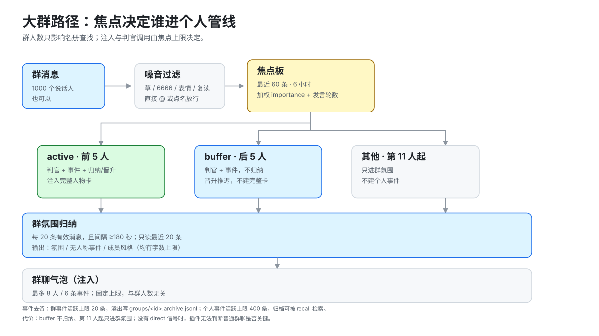
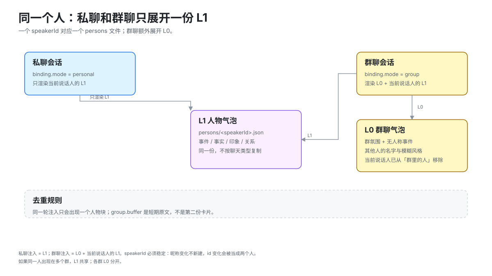
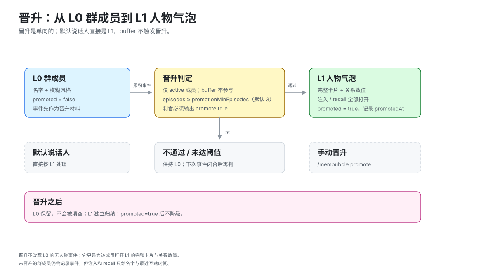
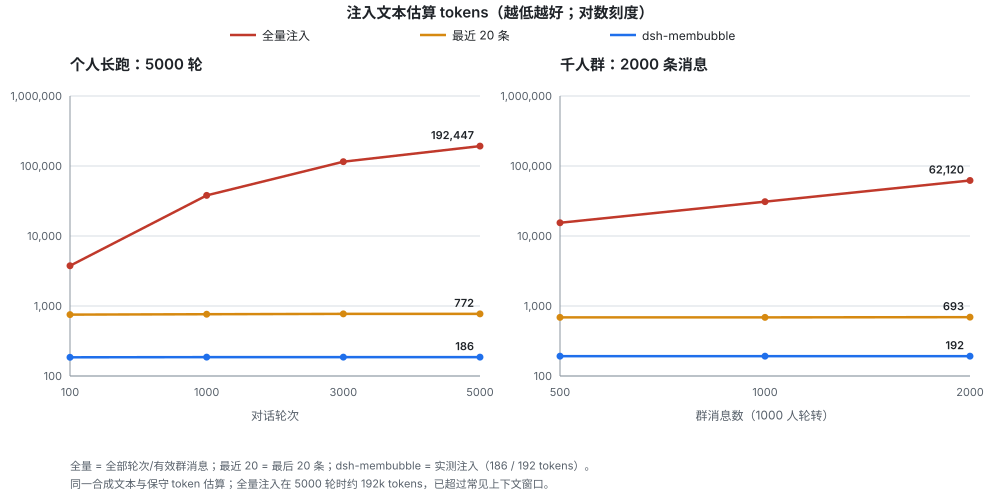

# dsh-membubble

给 dsh 对话角色做按人、按群隔离的记忆，面向长期运行和大群聊。

插件监听每一轮对话，判断话题有没有结束。闭合的话题写成一条事件，攒够若干条重归纳一次人物气泡。注入时只渲染当前说话人有权看到的部分，字数和 token 各有一条硬上限。被活跃列表挤出的事件写进 append-only 归档，检索时仍然找得回来。

记忆分成 L0 群聊气泡、L1 人物气泡、L2 完整人物卡三层。分层是实现手段，下面这三条才是插件对外保证的边界。

| 约束 | 实现 |
|---|---|
| 注入不随运行时长增长 | 每次注入同时受 `maxInjectChars` 和 `maxInjectTokens` 约束；超预算先丢【回忆】，人物卡保留 |
| 大群不随人数线性变慢 | 对话焦点只看最近 60 条、6 小时内的消息，前 5 人参与事件与归纳/晋升，后 5 人只记事件，第 11 人起只进群氛围；灌水在入口过滤 |
| 进入管线的事件不静默消失 | 活跃事件有上限，溢出写 append-only JSONL 归档；高 importance 事件最后淘汰；`membubble_recall` 同时检索活跃与归档 |

本仓库是 `dsh-membubble` 包自身，没有构建步骤。

**状态**：0.1.2，开发者预览。验证环境 `@deepseek-ai/dsh 0.2.2-rc.1`、Node 24；67 项单元测试和 1 个集成 harness 通过；尚未发布到 npm。

包名用 `dsh-membubble`，因为 npm 上的 `dsh-bubble` 已被一个无关的 macOS 悬浮气泡插件占用。工具、命令、服务 key 和数据目录统一用 `membubble`，搜索和运行时不留两套叫法。

## 背景

长期对话里，把历史全量拼进 prompt 会让注入体积随轮次线性增长。大群聊里按人建卡，又会让人数直接乘到模型调用次数上。插件用三件事把这两条曲线压平，归纳成气泡代替原文、焦点决定谁进个人管线、归档兜住被挤出活跃列表的事件。

## 三层



- **L0 的最终字段不是聊天记录。** `vibe` / `scene` / `events` 保存「有人争论过一个技术方案，最后不了了之」，不保存谁说了什么。已知成员名在写入这些字段之前会替换成「有人」。
- **`group.buffer` 是例外。** 它是待归纳的短期原文，带说话人名，归纳成功即清空。模型连续失败时最多保留 60 条，属于明文数据，会落盘。
- **L1 按人隔离。** 事实、印象、事件都在那个人的文件里。给 A 渲染上下文时读不到 B 的卡片。
- **晋升是单向的。** 晋升后的成员不会因为一段时间没互动而退回 L0，避免出现「有时记得、有时不记得」的观感。
- **默认说话人例外。** `defaultSpeakerId` 视为已经认识，直接按 L1 处理；其他群成员需要过晋升判定。

## 边界与前置条件

「上下文和 token 稳定」指的是这个插件注入的那一段 system section 有固定上限，不含整个会话的历史长度。DSH 自己的对话历史与压缩由宿主负责，插件不读写它们。

在普通 Web 会话里，一个会话按一个说话人处理，默认取 `defaultSpeakerId`，可以当单人物气泡使用。要处理真实的多说话人群聊，传输层需要在每轮告诉插件是谁说的。

```js
ctx.get('membubble').observeTurn({
  sessionId,
  userText,
  assistantText,
  speaker: { id, name },
  direct: false, // @ 她 / 回复她时传 true；不传时按 agentName 和 @ 前缀猜
})
```

没有 `speaker` 也没有 `bind` 的群聊，插件只能把所有人当成默认说话人，群聊气泡、焦点和晋升都不会被真实群消息驱动。仓库里的集成 harness 用假事件模拟了这个过程，它不是任何真实聊天平台的传输层。

## 安装

运行环境是 dsh 0.2 系列（验证版本 0.2.2-rc.1）、Node 24 和一个已建好的 profile。下面的例子用 `web`。

### 从 GitHub 安装

```powershell
dsh plugin --profile web add github:BurninIce/dsh-membubble
```

本机不能直连 GitHub，或者想先改代码时，复制目录进 profile。

```powershell
$dst = "$env:USERPROFILE\.dsh\profiles\web\node_modules\dsh-membubble"
New-Item -ItemType Directory -Force $dst | Out-Null
Copy-Item .\lib, .\cordis.patch.yml, .\package.json, .\README.md, .\LICENSE $dst -Recurse
```

也可以用 `dsh plugin --profile web add link:<本仓库路径>`。pnpm 会提示链接包不会从自己的 `node_modules` 解析 peer，这里的 `@deepseek-ai/*` 由 dsh profile runtime 解析。不熟悉这种布局时用上面的复制方式。

### 加进 bundle 列表

编辑 `~/.dsh/profiles/web/package.json`。

```json
{
  "dependencies": {
    "dsh-membubble": "0.1.2"
  },
  "dsh": {
    "profile": {
      "bundles": [
        "@deepseek-ai/dsh-base",
        "@deepseek-ai/dsh-web-app",
        "dsh-membubble"
      ]
    }
  }
}
```

### 写配置行

编辑 `~/.dsh/profiles/web/cordis.patch.yml`。

```yaml
- id: membubble
  config:
    namespace: demo
    agentName: 角色
    defaultSpeakerId: u_1001
    defaultSpeakerName: 阿川
```

重启 `dsh web`，检查加载结果。

```powershell
dsh --profile web --dump-config | Select-String -Pattern "id: membubble" -Context 0,10
```

输出里应该有 `name: dsh-membubble` 和合并后的配置。启动日志出现 `did not activate` 说明该 entry 没有激活，常见原因是 `apply()` 抛错或依赖服务未就绪，需要看 profile 日志。

## 使用

### 命令

| 命令 | 用途 |
|---|---|
| `/membubble` | 查看绑定与记忆状态 |
| `/membubble bind personal [名字]` | 按私聊处理当前会话 |
| `/membubble bind group <群号> [群名]` | 绑定到群聊 |
| `/membubble speaker <id> <名字>` | 指定当前说话人 |
| `/membubble recall <关键词>` | 检索当前说话人的事件 |
| `/membubble promote` | 手动晋升当前说话人 |
| `/membubble forget <编号>` | 删除一条事件 |
| `/membubble help` | 用法 |

### 工具

| 工具 | 用途 |
|---|---|
| `membubble_recall` | 按关键词或问句检索当前说话人的事件 |
| `membubble_remember` | 显式记一条事实（≤30 字，importance 1–3） |
| `membubble_status` | 查看绑定、关系数值、事件与归档条数、注入预算、焦点状态 |

对未晋升的群成员，`membubble_recall` 只返回最近几条事件并标注「还不太熟」，不暴露卡片。`membubble_remember` 也不绕过晋升，群聊里未晋升成员写入的事件同样只作为晋升材料。

### 服务 API

插件通过 `ctx.provide('membubble', …)` 暴露一组方法，供传输层或其他插件接线，调用方不需要直接碰 JSON 文件。

```js
const membubble = ctx.get('membubble')

// 把一个会话绑定到群聊和说话人
membubble.bind(sessionId, {
  mode: 'group',
  groupId: 'g_1001',
  groupName: '测试群',
  speakerId: 'u_1001',
  speakerName: '小林',
})

// 传输层已经知道是谁说的，直接观察这一轮
await membubble.observeTurn({
  sessionId,
  userText: '我在学手冲咖啡',
  assistantText: '哦？说说看。',
  speaker: { id: 'u_1001', name: '小林' },
  direct: false, // @ 她 / 回复她时传 true，强制按 active 处理
})

membubble.context({ sessionId, query: '咖啡' })
membubble.recall({ sessionId, query: '咖啡', limit: 4 })
membubble.remember({ sessionId, text: '他下个月搬去杭州', importance: 3 })
membubble.status(sessionId)
membubble.summary(sessionId)
membubble.promote(sessionId)
```

多说话人会话有两种接法，每轮把 `speaker` 传给 `observeTurn`，或者在每轮前用 `bind` 切到新说话人。

## 一轮对话的处理路径



群聊先由焦点决定谁进入这条管线；私聊直接进入。模型调用在后台队列里执行，慢判官不会阻塞回复。判官失败时保留缓冲，下一轮再判，不写半成品事件。

## 注入内容

下面的对话由脚本生成，不是真实用户数据。右侧是同一轮注入到 system prompt 的记忆段。

私聊：



群聊：



section 在 `agent/created` 时按 agent 注册，order `8100`，`interpolate: false`，因此记忆文本里出现 `{{…}}` 也不会被当成提示词变量。渲染同时受 `maxInjectChars` 和 `maxInjectTokens` 约束，超预算先丢【回忆】，仍然超限时优先保留人物卡，群氛围让位。token 数是保守估算，中文按 1.6 token/字、其他按 4 字符/token，只用于守上限，不用于计费。

## 大群下的焦点与代价



群人数只影响名册查找，不影响注入文本和判官调用次数。焦点板只保留最近 `focusWindow` 条（默认 60）且在 `focusTtlSec`（默认 6 小时）内的消息，按 uid 聚合。前 `focusActive`（5）人进个人记忆管线并触发归纳/晋升，后 `focusBuffer`（5）人只记事件、不归纳；第 11 人起只进群氛围。

代价是明确的。buffer 的事件会被记录，但归纳和晋升推迟；第 11 人起只进群氛围，不建个人事件。传输层知道某句话是直接对角色说的时，传 `direct: true`，或者让文本包含 `agentName` 或 `@`，这个人会被强制按 active 处理。没有这个信号时，插件无法从一条普通群聊判断它是否关键。

## 同一个人：私聊和群聊只展开一份 L1



一个人的身份键是 `speakerId`，不是昵称。`bind()` 或 `observeTurn()` 传同一个 `speakerId`，私聊和群聊读写的都是 `persons/<speakerId>.json` 这同一份 L1 文件；群聊只是额外带一个 L0 群聊气泡。

- 私聊注入：只有当前说话人的 L1。
- 群聊注入：L0 群聊气泡 + 当前说话人的 L1。
- `renderGroup()` 会把当前说话人从「群里的人」列表中排除；他们的名字和风格只出现在 L1 卡片里，不会在群成员列表里再出现一次。
- `group.buffer` 是待归纳的短期原文，不是第二份人物卡。
- 同一人出现在多个群时，L1 共享，各群 L0 分开；昵称变化不会新建人物，`speakerId` 变化会被当成两个人。

## 晋升：从 L0 群成员到 L1 人物气泡



群成员一开始只有 L0 里的名字和模糊风格，`promoted = false`。事件照常记录，但注入和 `membubble_recall` 只给名字与最近互动时间，不给卡片。

晋升发生在一个 active 成员的事件闭合之后：

1. 该成员的 `episodes.length` 达到 `promotionMinEpisodes`（默认 3）。
2. 插件单独调用一次晋升判官，输入事件数、重要事件数、互动次数、是否已有事实/印象/风格。
3. 判官必须输出 `promote: true`；否则保持 L0，下次事件闭合后再判。
4. 通过后写入 `promoted = true`、`promotedAt`，并把群成员条目标成已晋升。

之后注入才展开完整卡片、关系数值、风格和 recall；`promoted` 是单向的，不会因为一段时间没互动退回 L0。默认说话人直接按 L1 处理；私聊也会把已经存在的人物文件标成 `promoted`，避免同一个人先私聊、后在群里被当成陌生人。buffer 成员只记事件，不触发晋升；也可以 `/membubble promote` 手动晋升。

晋升不是把 L0 群聊气泡改写成人物卡。L0 仍然独立存在，继续只保存无人称的氛围和事件；L1 是该成员自己的卡片。`promoted` 以 person 文件为准，群成员条目只是缓存，下一次该群观察到他时会同步。

## 记忆隔离

下面这些是代码约束，不只写在 prompt 里。

1. **按人隔离。** 事实和印象存在那个人的文件里。`context()` 只读解析出来的说话人的文档，`renderPerson()` 也拿不到别人的卡片。
2. **群聊气泡不存言论。** `applyGroupUpdate()` 只接受 `vibe`、`scene` 和无人称的 `events`，已知成员名会替换成「有人」，不接受成员风格。
3. **风格来自本人，不来自群摘要。** 成员风格在本人归纳时产生，再复制到群成员条目。
4. **未晋升成员有闸门。** 进入个人管线的未晋升成员，事件会存下来作为晋升材料，但注入块和 `membubble_recall` 只给名字与最近互动时间。
5. **数值只能小步走。** 每次归纳好感、信任最多 ±8，熟悉度最多 +6。关系档由数值推导，不由模型直接选。
6. **焦点先决定谁进管线。** 群聊里只有焦点 active 的成员会触发归纳和晋升；buffer 记事件但不归纳，榜外成员则只进群氛围，避免 1000 人各建一张卡。

## 检索

检索是词法的，不依赖 embedding。

- 中文按字符 bigram 切，英文按单词切。
- 分数为查询覆盖率 × 0.55 + 近因（30 天半衰）× 0.25 + 重要度 × 0.2。
- 「你还记得……」这类问句走近因权重更高的分支。
- 空查询按近因取最近事件。

接口是 `retrieve(person, query, { now, limit })`。以后换成混合检索或 embedding，不需要改存储格式。

## 配置

| 字段 | 默认值 | 含义 |
|---|---|---|
| `enabled` | `true` | 关闭观察与注入；工具仍可读 |
| `dataDir` | `$DSH_HOME/membubble` | 数据根目录；namespace 会追加在后面 |
| `namespace` | `default` | 角色/部署命名空间；不同角色必须分开 |
| `applyToSubagents` | `false` | 是否也观察、注入子 agent 会话 |
| `agentName` | `''` | 判官 prompt 里的角色名 |
| `defaultSpeakerId` / `defaultSpeakerName` | `owner` / `你` | 没有绑定时的说话人 |
| `speakerPrefix` | `false` | 是否识别 `名字：` 作为说话人 |
| `provider` / `model` | `''` | 判官路由；留空沿用会话最后一次请求 |
| `temperature` / `timeoutMs` | `0.2` / `60000` | 判官参数 |
| `boundaryMaxTokens` | `400` | 话题边界判定输出上限 |
| `inductMaxTokens` | `900` | 人物卡归纳输出上限 |
| `groupMaxTokens` | `400` | 群聊气泡输出上限 |
| `promotionMaxTokens` | `160` | 晋升判定输出上限 |
| `bufferCap` | `8` | 缓冲达到该轮数强制闭合 |
| `boundaryCheck` | `true` | 每轮都判；关掉后只在缓冲满时判 |
| `inductEvery` | `5` | 每 N 条事件重归纳 |
| `forgetDays` | `30` | `importance = 1` 的事件保留天数 |
| `retrieveLimit` | `4` | 注入的回忆条数 |
| `maxInjectChars` | `1600` | 注入文本字数上限 |
| `maxInjectTokens` | `1400` | 注入文本的保守 token 估算上限 |
| `maxGroupMembers` | `8` | 群聊气泡里最多列几个成员 |
| `groupEnabled` | `true` | 是否维护群聊气泡 |
| `groupUpdateEvery` | `20` | 每 N 条有效群消息更新群聊气泡 |
| `groupMinIntervalSec` | `180` | 两次群氛围归纳的最小间隔 |
| `groupSummaryTurns` | `20` | 群氛围归纳读最近多少条 |
| `focusWindow` | `60` | 对话焦点窗口条数 |
| `focusTtlSec` | `21600` | 焦点条目有效期（6 小时） |
| `focusActive` | `5` | 进入个人记忆管线的活跃人数 |
| `focusBuffer` | `5` | 只记事件、不归纳的缓冲人数 |
| `focusTurnWeight` | `0.5` | 发言轮数的评分权重 |
| `focusImportantMult` | `5` | importance ≥2 的跳级倍数 |
| `focusDirectImportance` | `3` | @ / 点名的焦点权重 |
| `memberTtlSec` | `2592000` | 未晋升成员保留时间（30 天） |
| `maxGroupMembersStored` | `200` | 群成员记录上限 |
| `archiveRecallLimit` | `2000` | 归档检索最多读多少条 |
| `promotionEnabled` | `true` | 是否自动晋升 |
| `promotionMinEpisodes` | `3` | 进入晋升判定前至少要有几条事件 |

## 存储

```text
<dataDir>/<namespace>/
├─ persons/<safeId>.json            # 人物气泡（活跃事件）
├─ persons/<safeId>.archive.jsonl   # 被活跃上限挤出的事件，append-only
├─ groups/<safeId>.json             # 群聊气泡（活跃事件）
├─ groups/<safeId>.archive.jsonl    # 被活跃上限挤出的群事件
└─ bindings.json                    # sessionId → { mode, groupId, speakerId, … }
```

- 活跃事件和归档分开存放。活跃文件保持小而稳定，归档只追加，不在每次写入时重写。
- 归档是明文 JSONL，和活跃文件同权限（`0600`）。目前没有自动轮转，长期运行会持续增大。
- `membubble_recall` 同时检索活跃事件和归档，被移出活跃列表不等于找不回来。
- 一个实体一个文件。某个文件损坏只影响一个人，不会拖垮全部气泡。
- 解析失败的文件先复制成 `.corrupt-<时间戳>`，避免被下一次写入覆盖。
- 写入走临时文件加 rename。文件 `0600`、目录 `0700`（平台支持时）。
- 文档在内存里缓存，因为提示词组装每一步都会读。这个缓存假设一个进程在写同一个 namespace。

## 限制

- 没有传输层。多说话人群聊依赖传输层调用 `observeTurn` 并带上 `speaker`，或者使用 `名字：` 前缀约定。
- 群聊焦点是有意的取舍。buffer 的事件照记，但不归纳、不晋升；第 11 人起只进群氛围。没有 `direct`、`@`、`agentName` 信号时，插件无法判断一句普通群聊是否关键。
- 群缓冲只保留最近 60 条原文，归纳模型连续失败时会先满后丢最旧几条。完整原文在 DSH 会话日志里，群氛围归纳看不到更早的部分。
- 话题缓冲（pending）在判官持续失败时最多保留 16 轮，更早的轮次会被丢弃，不进入事件库。正常路径每轮都会尝试闭合。
- `membubble_recall` 的归档检索只读最近 `archiveRecallLimit` 条（默认 2000）。更老的归档仍在盘上，但不会自动进入检索结果。
- 未晋升且长期不活跃的人物文档目前不会自动删除，被清理的只有群成员索引。长期接待大量一次性群友时，`persons/` 仍会积累，需要外部清理或备份策略。
- 归档只追加、不轮转，长期运行会持续占盘，需要自行做外部备份或清理。
- token 是保守估算，不是精确 tokenizer。上限是硬的，具体数值可能偏大。
- 没有管理界面。状态通过 `/membubble`、`membubble_status` 和服务 API 查看。
- 没有 embedding 检索、`supersedes` 取代链、滚动备份。`forget` 直接删除事件。
- 记忆是明文 JSON，插件不做加密。
- 一个进程一条串行队列。多群高并发需要按 key 拆队列。
- 写入假设单进程。两个 dsh 进程共享同一个 namespace 时会互相覆盖文档。
- 群文本脱敏只处理两个字符以上的名字，单字昵称不会被替换。

## 测试

67 项单元测试，覆盖模型输出上限、归纳步长、群文本脱敏、检索排序、渲染预算、对话焦点排序与过期与晋升回填、噪音过滤、token 预算截断、事件归档与归档召回、三种注入状态（私聊、已晋升群成员、未晋升群成员）、同群两人隔离、晋升、`remember` 与 `forget`、轮次抽取，以及损坏存储处理。

```sh
# 单元测试
npm test

# 两类规模测试（假模型，约 40 秒）
npm run test:scale
```

`test:scale` 不跑真实模型，也不测吞吐上限，它验证的是焦点、归档、预算在长轮次和大群输入下能不能守住边界。

### 规模测试结果

测试环境为 Windows 11、Node 24.21.0、dsh 0.2.2-rc.1、临时 `DSH_HOME`。判官是确定性假模型，不联网，不调用真实 LLM。耗时包含每次落盘，数值随机器和消息长度变化。复现脚本为 [personal.mjs](tests/scale/personal.mjs)、[group.mjs](tests/scale/group.mjs)。

#### 与全量注入和窗口截断的对比

同一条合成对话、同一套保守 token 估算，对比三种注入方式。全量注入是所有用户与角色轮次，群聊为所有有效消息；最近 20 条只保留最后 20 条；dsh-membubble 是实测的卡片加焦点召回。



个人对话：

| 轮次 | 全量注入 | 最近 20 条 | dsh-membubble |
|---:|---:|---:|---:|
| 100 | 3,756 | 753 | 185 |
| 1,000 | 38,047 | 763 | 186 |
| 3,000 | 115,247 | 772 | 186 |
| 5,000 | 192,447 | 772 | 186 |

千人群（1000 人轮转，每 10 条 1 条噪音）：

| 消息数 | 全量注入 | 最近 20 条 | dsh-membubble |
|---:|---:|---:|---:|
| 500 | 15,455 | 688 | 192 |
| 1,000 | 30,935 | 688 | 192 |
| 2,000 | 62,120 | 693 | 192 |

关键事件保留（个人长跑，第 500 轮设为 importance 3）：

| 方案 | 第 500 轮事件 | 5000 轮注入 | 说明 |
|---|---|---:|---|
| 全量注入 | 在 | 192,447 | 不丢，但线性增长并超出常见窗口 |
| 最近 20 条 | 不在 | 772 | 有界，但旧事件被窗口挤掉 |
| dsh-membubble | 在，且可 recall | 186 | 活跃列表优先保留高 importance，归档可召回 |

全量注入在 5000 轮时约为 dsh-membubble 的 **1000 倍**，千人群 2000 条消息时约为 **320 倍**。最近 20 条同样有界，但第 500 轮的关键事件已经不在窗口里。

- 与全量注入比，5000 轮是 192,447 对 186 tokens，千人群 2000 条是 62,120 对 192。
- 与最近 20 条比，772 对 186、693 对 192，membubble 只有它的四分之一到三分之一，少掉的是原文，换来的是归纳后的卡片和一条可召回的归档。
- 与摘要或卡片类实现比，membubble 也做归纳，额外保留的是 append-only 归档和可检索的旧事件，对应的代价是焦点取舍和磁盘增长。

下表的机制对比按各形态的通用做法列出，不是对某个具体第三方插件的实测。不同插件的注入接口和存储格式不同，没有同条件跑它们的代码。

| 形态 | 注入量 | 旧事件 | 主要代价 |
|---|---|---|---|
| 全量注入 | O(轮次/群消息) | 全保留 | 很快超出上下文窗口 |
| 最近 20 条窗口 | O(1) | 旧事件丢失 | 简单，但没有长期记忆 |
| 摘要 / 卡片 | O(1) | 压缩后细节可能丢失 | 质量依赖归纳模型 |
| 向量检索 top-k | O(k) | 可召回 | 需要 embedding，召回不保证 |
| dsh-membubble | O(1)，186/192 tokens | 活跃列表 + append-only 归档 | 焦点取舍；归档持续占盘 |

#### 个人长跑 5000 轮

每一轮都闭合为一个事件，比真实对话更激进，正常话题会跨多轮。每 500 轮有一个 importance 3 的事件。注入预算用默认的 `maxInjectChars=1600` / `maxInjectTokens=1400`。

| 轮次 | 注入 tokens | 活跃事件 | 归档事件 |
|---:|---:|---:|---:|
| 100 | 185 | 100 | 0 |
| 1000 | 186 | 400 | 600 |
| 3000 | 186 | 400 | 2600 |
| 5000 | 186 | 400 | 4600 |

结果：

- 5000 轮、5100 次假判官调用、约 26 秒，每次落盘约 5 ms。
- 活跃事件稳定在 400，归档 4600；注入从 185 到 186 tokens，没有随轮次增长。
- 第 4500 轮的关键事件仍在活跃列表，第 3000 轮的归档事件仍能被 `membubble_recall` 找到。
- 上下文最终 186 tokens / 209 字，远低于 1400 token / 1600 字上限。

#### 模拟千人群 1000 人 / 2000 条消息

每 10 条有 1 条 `6767` 噪音，共 200 条，其余 1800 条为有效发言。群氛围每 20 条归纳一次，共 90 次。`boundaryCheck=false`，所以这里只测群规模与上下文路径，不测个人事件质量。表中的 10 个人物文档只验证建壳与隔离路径，不产生个人事件，个人事件路径由上面的长跑测试覆盖。

| 消息数 | 有效 | 注入 tokens | 活跃群事件 | 群事件归档 | 焦点条目 | 群成员 | 人物文档 |
|---:|---:|---:|---:|---:|---:|---:|---:|
| 500 | 450 | 192 | 20 | 2 | 60 | 10 | 10 |
| 1000 | 900 | 192 | 20 | 25 | 60 | 10 | 10 |
| 2000 | 1800 | 192 | 20 | 70 | 60 | 10 | 10 |

结果：

- 1000 个不同说话人、2000 条消息、约 8–12 秒（本机两次运行），90 次群氛围归纳。
- 焦点板稳定在 60 条，群成员记录 10 人，人物文档 10 个（5 active + 5 buffer），焦点之外的人不建人物。
- 群事件活跃 20 条，归档 70 条，群缓冲最终为 0。
- 注入 192 tokens / 222 字，低于测试配置的 400 token / 600 字上限。
- 200 条噪音没有进入焦点、群缓冲或模型调用。

集成 harness 在 `tests/integration/membubble.mjs`，在真实 Cordis 上下文上驱动模块，需要本机有 dsh 安装。

```powershell
$root = npm root -g
$env:DSH_PKG_ROOT = "$root\@deepseek-ai\dsh\node_modules"
npm run test:integration
```

CI 跑语法检查、单元测试和 `npm pack --dry-run`。集成 harness 不在 CI 里，因为它需要一份 dsh 安装。

## 隐私

- 发给判官模型的是缓冲的用户与 assistant 轮次、事件文本和卡片条目。群摘要在 prompt 里被要求写成无人称，已知成员名在落盘前会替换成「有人」。
- 群缓冲（`group.buffer`）会短期保存带说话人名的原文，归纳成功后清空。归档文件保存与活跃记忆相同的内容。两者都是明文。
- 不发送遥测。
- 数据在 `$DSH_HOME/membubble/<namespace>`，明文 JSON 与 JSONL，未加密。

## 许可证

MIT。见 [LICENSE](LICENSE)。
